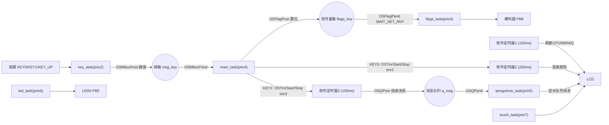
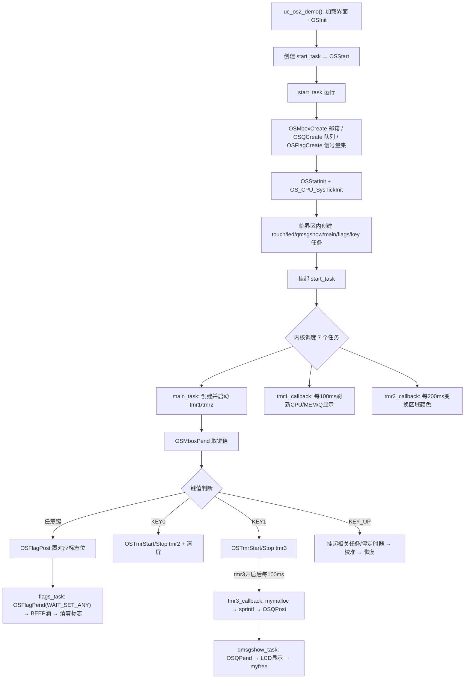

# 实验53 UCOSII实验3-消息队列、信号量集和软件定时器

> 平台：正点原子 战舰 STM32F103 开发板 · HAL 库 · Keil MDK · uC/OS-II V2.93.01

## 一、实验简介

本实验是 uC/OS-II 系列的进阶篇，在信号量、邮箱的基础上再学习三种内核机制：**消息队列（Message Queue）**、**信号量集（Event Flag Group）**和**软件定时器（Software Timer）**。系统创建 7 个任务，并用 3 个软件定时器周期性地做后台工作：定时器1（100ms）刷新 CPU/内存/队列使用率，定时器2（200ms）在固定区域变换颜色，定时器3（100ms）自动往消息队列里投递消息；队列消息显示任务从队列取出并显示；信号量集任务用"任一按键按下即触发"的方式让蜂鸣器"滴"一声。

🏠 **生活类比**：
- **消息队列**像一排信箱（多格），可以缓存多条消息排队等人来取，比只有单格的邮箱容量大。
- **信号量集**像一组开关面板（多个标志位），可以设成"任意一个开关闭合就通知"（WAIT_SET_ANY）或"全部闭合才通知"（WAIT_SET_ALL）。
- **软件定时器**像家里的定时插座，到点自动执行一件后台小事（刷新显示、投消息），不必占用主逻辑。

## 二、实验目的

- 掌握**消息队列**的创建与使用：`OSQCreate()` / `OSQPost()` / `OSQPend()`
- 掌握**信号量集**的创建与使用：`OSFlagCreate()` / `OSFlagPost()` / `OSFlagPend()`（含 `OS_FLAG_WAIT_SET_ANY`）
- 掌握**软件定时器**的创建与控制：`OSTmrCreate()` / `OSTmrStart()` / `OSTmrStop()` 及回调函数
- 理解定时器回调 + 消息队列 + 动态内存（`mymalloc/myfree`）配合实现"后台生产消息、前台消费显示"
- 综合协调 7 个任务与多种通信对象，深入体会 RTOS 的并发编程模型

## 三、硬件资源与连接图

| 外设 | 引脚 | 说明 |
|------|------|------|
| LED0 (DS0, 红) | **PB5** | 低电平点亮，LED 任务控制，提示运行 |
| LED1 (DS1, 绿) | **PE5** | 低电平点亮，按 KEY0 相关控制 |
| 蜂鸣器 BEEP | **PB8** | 信号量集任务触发时"滴"一声 |
| 按键 KEY0 | **PE4** | 启动/停止软件定时器2（控制屏幕颜色刷新）+ 清触摸区 |
| 按键 KEY1 | **PE3** | 启动/停止软件定时器3（控制消息队列发送） |
| 按键 KEY2 | **PE2** | （硬件在位） |
| 按键 KEY_UP (WK_UP) | **PA0** | 触摸屏校准（仅电阻屏有效） |
| TFTLCD + 触摸屏 | 16 位 8080 并口 | 绘图、显示 CPU/MEM/Q 值与队列消息 |



> 说明：主任务收到按键后，一边把键值置入**信号量集**通知 flags_task 响蜂鸣器，一边根据 KEY0/KEY1 **开关软件定时器2/3**。定时器3 一旦开启，就每 100ms 往**消息队列**投一条消息，qmsgshow_task 取出后在 LCD 的 QUEUE MSG 区显示；定时器1 则实时显示队列长度 Q 和内存占用 MEM，直观看到消息"堆积—消耗"的过程。

## 四、内核对象与 API（本节为 RTOS 内核概念，不涉及硬件寄存器）

本实验在信号量/邮箱之外，新增**消息队列**、**信号量集**、**软件定时器**三种机制：

| API / 概念 | 作用 |
|-----------|------|
| `OSQCreate(&MsgGrp[0], size)` | 创建消息队列，`MsgGrp` 是存放消息指针的数组，`size` 为队列深度（本例 256） |
| `OSQPost(q, msg)` | 向队列尾部投递一条消息（一个指针），队满返回错误 |
| `OSQPend(q, timeout, &err)` | 从队列头取一条消息，队空则阻塞等待 |
| `OSFlagCreate(flags, &err)` | 创建信号量集（一组标志位），初值本例为 0 |
| `OSFlagPost(grp, flags, opt, &err)` | 置位/清零标志，`OS_FLAG_SET` 置位、`OS_FLAG_CLR` 清零 |
| `OSFlagPend(grp, flags, wait_opt, timeout, &err)` | 等待标志，`OS_FLAG_WAIT_SET_ANY` 任一置位即返回 |
| `OSTmrCreate(delay, period, opt, callback, arg, name, &err)` | 创建软件定时器，`OS_TMR_OPT_PERIODIC` 为周期模式 |
| `OSTmrStart(tmr, &err)` / `OSTmrStop(tmr, opt, callback, &err)` | 启动 / 停止软件定时器 |
| `OS_TMR_CALLBACK` | 定时器回调函数类型，到点由定时器任务自动调用 |
| `OS_Q` / `OSQEntries` | 队列控制块，`OSQEntries` 是当前队列中的消息条数 |

**软件定时器节拍说明**：uC/OS-II 软件定时器的时间单位是 `OS_TMR_CFG_TICKS_PER_SEC`（定时器节拍，本例 100 Hz，即每 tick = 10ms），与任务调度节拍 `OS_TICKS_PER_SEC` 相互独立。

```
tmr1 = OSTmrCreate(10, 10, PERIODIC, ...) → 首次10tick(100ms), 周期100ms
tmr2 = OSTmrCreate(10, 20, PERIODIC, ...) → 首次100ms, 周期200ms
tmr3 = OSTmrCreate(10, 10, PERIODIC, ...) → 首次100ms, 周期100ms
```

## 五、软件架构 / 流程



任务优先级：key(2) > flags(3) > main(4) > qmsgshow(5) > led(6) > touch(7) > start(10)。软件定时器回调运行在 uC/OS-II 内部的**定时器任务**上下文中，不属于上面这些应用任务。

## 六、主要示例代码及讲解

### 1. 创建消息队列与信号量集（`User/uc-os2_demo.c`，start_task 内）

```c
OS_EVENT    *msg_key;   /* 按键邮箱事件块 */
OS_EVENT    *q_msg;     /* 消息队列 */
OS_FLAG_GRP *flags_key; /* 按键信号量集 */
OS_TMR      *tmr1, *tmr2, *tmr3;  /* 三个软件定时器 */
void *MsgGrp[256];      /* 消息队列存储地址,最大支持256个消息 */

// start_task 内:
msg_key   = OSMboxCreate((void *)0);   /* 创建消息邮箱 */
q_msg     = OSQCreate(&MsgGrp[0], 256);/* 创建消息队列,深度256 */
flags_key = OSFlagCreate(0, &err);     /* 创建信号量集,初值0 */
```

**讲解**：
- 消息队列需要一个**指针数组** `MsgGrp[256]` 作为消息存放区，`OSQCreate` 把它和队列控制块关联，队列最多缓存 256 条消息。
- 信号量集用 `OS_FLAG_GRP *` 表示（区别于信号量/邮箱/队列的 `OS_EVENT *`），`OSFlagCreate(0, &err)` 创建时所有标志位清零。

### 2. 软件定时器的创建、开关与回调（`uc-os2_demo.c`，main_task 内）

```c
/* 创建 3 个周期性软件定时器 */
tmr1 = OSTmrCreate(10, 10, OS_TMR_OPT_PERIODIC, (OS_TMR_CALLBACK)tmr1_callback, 0, (unsigned char*)"tmr1", &err); /* 100ms */
tmr2 = OSTmrCreate(10, 20, OS_TMR_OPT_PERIODIC, (OS_TMR_CALLBACK)tmr2_callback, 0, (unsigned char*)"tmr2", &err); /* 200ms */
tmr3 = OSTmrCreate(10, 10, OS_TMR_OPT_PERIODIC, (OS_TMR_CALLBACK)tmr3_callback, 0, (unsigned char*)"tmr3", &err); /* 100ms */
OSTmrStart(tmr1, &err);   /* 启动定时器1 */
OSTmrStart(tmr2, &err);   /* 启动定时器2 (tmr3 由KEY1控制,暂不启动) */

/* 按 KEY1 时开关定时器3 */
case KEY1_PRES:
    tmr3sta = !tmr3sta;
    if (tmr3sta) OSTmrStart(tmr3, &err);                    /* 开启 */
    else         OSTmrStop(tmr3, OS_TMR_OPT_NONE, 0, &err); /* 关闭 */
    break;
```

**讲解**：
- `OSTmrCreate(初值, 周期, 选项, 回调, 参数, 名字, &err)`：第一个 `10` 是首次触发的延时（tick），第二个是周期，`OS_TMR_OPT_PERIODIC` 表示周期性重复。到点后 uC/OS-II 自动调用对应的 `tmrx_callback`。
- 定时器创建后需 `OSTmrStart` 才生效；`OSTmrStop` 可随时停掉，实现"按 KEY1 才开始/停止往队列发消息"。
- 回调函数运行在定时器任务里，应尽量短小，不要做长时间阻塞操作。

### 3. 定时器回调投递队列消息 + 队列任务消费（`uc-os2_demo.c`）

```c
/* 定时器3回调: 每100ms生产一条消息投入队列 */
void tmr3_callback(OS_TMR *ptmr, void *p_arg)
{
    uint8_t *p;
    uint8_t err;
    static uint8_t msg_cnt = 0;
    p = mymalloc(SRAMIN, 13);                       /* 申请13字节内存 */
    if (p)
    {
        sprintf((char *)p, "ALIENTEK %03d", msg_cnt);/* 生成消息内容 */
        msg_cnt++;
        err = OSQPost(q_msg, p);                    /* 投入消息队列 */
        if (err != OS_ERR_NONE)                     /* 队满发送失败 */
        {
            myfree(SRAMIN, p);                      /* 释放内存 */
            OSTmrStop(tmr3, OS_TMR_OPT_NONE, 0, &err); /* 自动关闭定时器3 */
        }
    }
}

/* 队列消息显示任务: 消费队列 */
void qmsgshow_task(void *pdata)
{
    char *p;
    uint8_t err;
    while (1)
    {
        p = OSQPend(q_msg, 0, &err);                    /* 取一条消息(无消息则阻塞) */
        lcd_show_string(5, 170, 240, 16, 16, p, RED);   /* 在LCD显示 */
        myfree(SRAMIN, p);                              /* 用完释放内存 */
        OSTimeDly(500);
    }
}
```

**讲解**：
- 这是典型的"生产者—消费者"：定时器3 生产消息、qmsgshow_task 消费消息，中间用消息队列缓冲，二者速率可以不同。
- 队列传递的是**指针**，所以每条消息都要 `mymalloc` 动态申请内存；消费方显示后必须 `myfree` 释放，否则内存会耗尽（MEM 值一直涨）。
- `OSQPost` 失败（队列满）时主动释放内存并 `OSTmrStop` 关掉定时器3，防止内存泄漏和无限堆积。

### 4. 信号量集：任一按键触发（`uc-os2_demo.c`，flags_task 内）

```c
void flags_task(void *pdata)
{
    uint16_t flags;
    uint8_t err;
    while (1)
    {
        /* 等待信号量集: 低3位(KEY0/KEY1/KEY_UP)任意一位置1即返回 */
        flags = OSFlagPend(flags_key, 0X0007, OS_FLAG_WAIT_SET_ANY, 0, &err);
        if (flags & 0X0001) lcd_show_string(140, 162, 240, 16, 16, "KEY0 DOWN  ", RED);
        if (flags & 0X0002) lcd_show_string(140, 162, 240, 16, 16, "KEY1 DOWN  ", RED);
        if (flags & 0X0004) lcd_show_string(140, 162, 240, 16, 16, "KEY_UP DOWN  ", RED);
        BEEP(1); OSTimeDly(50); BEEP(0);            /* 蜂鸣器滴一声 */
        OSFlagPost(flags_key, 0X0007, OS_FLAG_CLR, &err); /* 全部标志清零 */
    }
}
```

**讲解**：主任务收到任意键值后用 `OSFlagPost(flags_key, 1 << (key-1), OS_FLAG_SET, &err)` 把对应标志位置 1。flags_task 用 `OS_FLAG_WAIT_SET_ANY` 等待——只要低 3 位（0x0007）中任意一位被置 1 就立即返回，据此判断是哪个键并让蜂鸣器"滴"一声，最后用 `OS_FLAG_CLR` 把标志全部清零，为下一次触发做准备。

## 七、实验效果

- **LED0（红）**闪烁提示运行；LCD 主界面显示 CPU、MEM（内存）、Q（队列消息数）等实时信息。
- 按 **KEY0**：启动/停止软件定时器2，屏幕固定区域随之刷新变换颜色 / 停止（显示 `TMR2 STOP`），并清除触摸输入区。
- 按 **KEY1**：启动软件定时器3，开始每 100ms 往队列投消息——LCD 上 Q 和 MEM 值逐渐变大，QUEUE MSG 区不断显示 `ALIENTEK 000/001/...`；再按一次 KEY1 停止定时器3，Q 和 MEM 逐渐减小，Q 归 0 后停止显示（队列清空）。
- 按 **KEY_UP**：触摸屏校准（仅电阻屏有效）。
- 任意按键按下时，信号量集触发蜂鸣器"滴"一声，并在 LCD 上提示对应的按键名。

## 八、注意事项

- 本实验使用的 uC/OS-II 版本为 **V2.93.01**；SysTick 中断在 `delay.c` 中，**不要重复实现**。
- 软件定时器的时间基准是 **定时器节拍**（`OS_TMR_CFG_TICKS_PER_SEC`），与任务调度节拍不同，计算周期时别混淆。
- 消息队列传递的是**指针**，配合 `mymalloc/myfree` 使用时务必"谁消费谁释放"，否则会内存泄漏（表现为 MEM 只增不减）。
- `OSQPost` 队满会失败，本例用"失败即停定时器3"来兜底；实际项目应考虑丢消息或扩大队列深度。
- 软件定时器回调运行在定时器任务上下文，应**短小精悍**，避免阻塞或耗时操作，以免影响其他定时器。
- `OSFlagPend` 消费完标志后要及时 `OSFlagPost(..., OS_FLAG_CLR, ...)` 清零，否则会反复触发。
- 修改代码后需重新编译烧录；若烧录失败先运行根目录 `keilkill.bat`。

## 九、文件结构

```
实验53 UCOSII实验3-消息队列、信号量集和软件定时器/
├── User/
│   ├── main.c                       主程序(HAL/时钟/LED/LCD/KEY/BEEP/触摸/SRAM初始化)
│   ├── uc-os2_demo.c                uC/OS-II 例程(7任务 + 队列/信号量集/软件定时器)【核心】
│   ├── uc-os2_demo.h                例程头文件
│   ├── stm32f1xx_it.c               中断服务函数
│   └── stm32f1xx_hal_conf.h         HAL 配置
├── Middlewares/
│   ├── MALLOC/                      内存管理(mymalloc/myfree,消息队列内存)
│   └── uC-OS2/                      uC/OS-II 内核源码 + 移植层(含软件定时器 os_tmr)
├── Drivers/
│   ├── BSP/
│   │   ├── LED/  KEY/  BEEP/        LED、按键、蜂鸣器驱动
│   │   ├── LCD/  TOUCH/  IIC/       液晶、触摸屏、IIC
│   │   └── 24CXX/  SRAM/            EEPROM、外部SRAM
│   ├── SYSTEM/(delay/sys/usart)     系统支持(SysTick 节拍在 delay.c)
│   ├── CMSIS/                       内核启动与设备定义
│   └── STM32F1xx_HAL_Driver/        ST HAL 库
└── Projects/MDK-ARM/                Keil 工程文件(.uvprojx)
```
