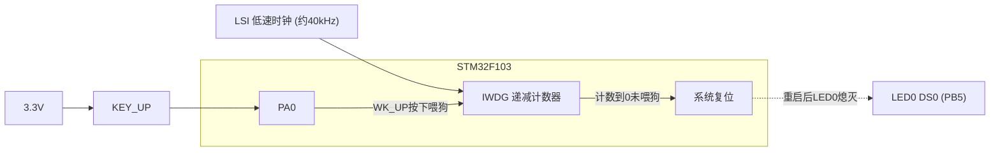
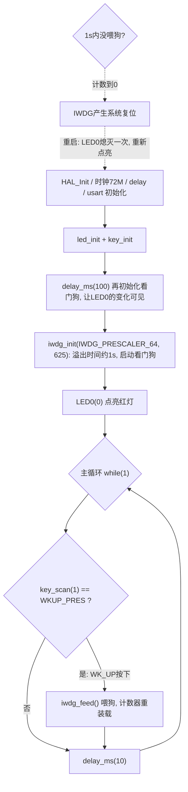

# 实验6 独立看门狗实验

> 平台：正点原子 STM32F103（战舰/精英/mini）开发板 · HAL 库 · Keil MDK

## 一、实验简介

本实验学习 **IWDG（独立看门狗）**：它是一个由独立低速时钟 LSI（约 40kHz）驱动的递减计数器，本实验设溢出时间约 1 秒。程序要求"1 秒内必须按下 WK_UP 按键喂狗（重装计数值）"，否则计数器减到 0 就产生**系统复位**。用 LED0 的亮灭即可直观看到看门狗是否复位了系统。

🏠 **生活类比**：看门狗就像独居老人的"平安打卡器"——规定每小时必须按一次按钮报平安（喂狗）；如果到点没按，系统就认定"人出事了"，自动打电话叫人来重启一切（复位）。程序跑飞卡死时，看门狗就是那个"自动重启"的保险。

## 二、实验目的

- 理解独立看门狗 IWDG 的工作原理与"防程序跑飞"作用
- 掌握 IWDG 溢出时间的计算：分频系数、重装载值与 LSI 40kHz 的关系
- 学会用 HAL 的 `HAL_IWDG_Init()` 初始化并启动看门狗
- 学会用 `HAL_IWDG_Refresh()` 喂狗，并结合按键实现"手动喂狗"

## 三、硬件资源与连接图

| 外设 | 引脚 | 说明 |
|------|------|------|
| 独立看门狗 IWDG | 无引脚 | 片内外设，时钟源为内部 LSI（约 40kHz） |
| KEY_UP (WK_UP) | **PA0** | 下拉输入，按下 = 高电平，用于喂狗 |
| LED0 (DS0, 红) | **PB5** | 低电平点亮，指示系统是否被复位 |



> 说明：IWDG 不需要任何外部引脚和外部时钟，完全在芯片内部运行；正因为使用独立的 LSI，即使主时钟故障它也能工作，所以叫"独立"看门狗。

## 四、核心寄存器（IWDG）

| 寄存器 | 名称 | 作用 |
|--------|------|------|
| `IWDG_KR` | 键寄存器 | 写 **0xCCCC** 启动看门狗；写 **0xAAAA** 喂狗（重装载）；写 **0x5555** 解锁，才允许访问 PR/RLR |
| `IWDG_PR` | 预分频寄存器 | 3 位，设置分频系数 4/8/16/32/64/128/256（本实验 64 分频） |
| `IWDG_RLR` | 重装载寄存器 | 12 位（0~0xFFF），计数初值，本实验 = 625 |
| `IWDG_SR` | 状态寄存器 | PVU/RVU 标志，指示 PR/RLR 正在同步更新，需等待写完成 |

**溢出时间计算**（LSI ≈ 40kHz）：

```
Tout = (分频系数 × 重装载值) / 40000 秒
     = (64 × 625) / 40000 = 1 秒
```

即 wdg.c 注释中的公式 `Tout = ((4 * 2^prer) * rlr) / 40 (ms)`。注意：IWDG 一旦启动（KR 写 0xCCCC）**无法用软件关闭**，只能靠复位。

## 五、软件架构 / 流程



## 六、主要示例代码及讲解

### 1. 看门狗初始化与喂狗（`Drivers/BSP/WDG/wdg.c`）

```c
IWDG_HandleTypeDef g_iwdg_handle;   /* 独立看门狗句柄 */

/**
 * @brief       初始化独立看门狗
 * @param       prer: IWDG_PRESCALER_4~IWDG_PRESCALER_256,对应4~256分频
 * @param       rlr: 自动重装载值,0~0XFFF.
 * @note        时间计算(大概):Tout=((4 * 2^prer) * rlr) / 40 (ms).
 */
void iwdg_init(uint8_t prer, uint16_t rlr)
{
    g_iwdg_handle.Instance = IWDG;
    g_iwdg_handle.Init.Prescaler = prer; /* 设置IWDG分频系数 */
    g_iwdg_handle.Init.Reload = rlr;     /* 重装载值 */
    HAL_IWDG_Init(&g_iwdg_handle);       /* 初始化IWDG并启动 */
}

/**
 * @brief       喂独立看门狗
 */
void iwdg_feed(void)
{
    HAL_IWDG_Refresh(&g_iwdg_handle); /* 重装载计数器 */
}
```

**讲解**：
- IWDG 配置只有两个参数：**分频系数 prer** 和 **重装载值 rlr**，两者共同决定溢出时间（64 分频 × 625 / 40kHz = 1s）。
- `HAL_IWDG_Init()` 内部依次完成：KR 写 0x5555 解锁 → 写 PR/RLR → 等待 SR 同步完成 → KR 写 0xCCCC **启动看门狗**。
- `HAL_IWDG_Refresh()` 就是往 KR 写 0xAAAA，把 RLR 的值重新装入计数器，即"喂狗"。
- 重装载值最大 0xFFF（4095），256 分频时溢出时间最长约 26 秒。

### 2. 主函数：按键喂狗（`User/main.c`）

```c
int main(void)
{
    HAL_Init();                             /* 初始化HAL库 */
    sys_stm32_clock_init(RCC_PLL_MUL9);     /* 设置时钟, 72Mhz */
    delay_init(72);                         /* 延时初始化 */
    usart_init(115200);                     /* 串口初始化为115200 */
    led_init();                             /* 初始化LED */
    key_init();                             /* 初始化按键 */
    delay_ms(100);                          /* 延时100ms再初始化看门狗,LED0的变化"可见" */
    iwdg_init(IWDG_PRESCALER_64, 625);      /* 预分频数为64,重载值为625,溢出时间约为1s */
    LED0(0);                                /* 点亮LED0(红灯) */

    while (1)
    {
        if (key_scan(1) == WKUP_PRES)       /* 如果WK_UP按下,则喂狗 */
        {
            iwdg_feed();                    /* 喂狗 */
        }

        delay_ms(10);
    }
}
```

**讲解**：
- `iwdg_init()` 之后看门狗立即开始倒计时，**1 秒内不喂狗系统就复位**，所以后面的代码节奏必须保证及时喂狗。
- 先 `delay_ms(100)` 再启动看门狗，是为了让复位后"LED0 熄灭一小段再点亮"的过程人眼可见，方便观察复位现象。
- `key_scan(1)` 用**连按模式**：按住 WK_UP 不放也能持续喂狗，符合"只要不停按就不会复位"的实验设计。
- `LED0(0)` 点亮红灯放在看门狗启动之后：一旦被复位，程序从头执行，LED0 会经历"熄灭（复位瞬间）→ 重新点亮"，看起来就是闪了一下。

### 3. 溢出时间速查（`iwdg_init` 参数组合示例）

```c
iwdg_init(IWDG_PRESCALER_64, 625);   /* 64分频,  重装625:  64*625/40000 = 1s   */
iwdg_init(IWDG_PRESCALER_32, 625);   /* 32分频,  重装625:  32*625/40000 = 0.5s */
iwdg_init(IWDG_PRESCALER_256, 625);  /* 256分频, 重装625:  256*625/40000 = 4s  */
```

**讲解**：记住公式 `Tout(ms) = 分频系数 × 重装载值 / 40`，即可根据需要的"容忍时间"反推 prer 与 rlr。分频越大可容忍时间越长，但精度受 LSI 偏差（±几个百分点）影响也越明显。

## 七、实验效果

烧录程序后：

- 如果看门狗没有复位，开发板的 **LED0 常亮**；
- 按下 WK_UP 按键就喂狗，只要不停地按，看门狗就一直不会产生复位，LED0 保持常亮；
- 一旦超过看门狗溢出时间（**Tout = 1s**）还没按键，程序将被复位重启，**LED0 熄灭一次再点亮**，看起来就是 LED0 闪了一下。

## 八、注意事项

- IWDG 由 **KR 写 0xCCCC 启动后无法软件关闭**，只能等复位或断电，因此 `iwdg_init()` 之后的主循环必须保证喂狗周期小于溢出时间。
- LSI 频率约 40kHz 且有偏差，实际溢出时间与计算值是"大概"关系，设计时留余量。
- 喂狗要放在**耗时最长的路径也能走到**的位置；本实验若把 `delay_ms` 改成大于 1s 的延时，即使一直按按键也会复位。
- 调试时若用 Keil 单步/断点暂停，可在调试配置里开启 "Freeze IWDG when core is halted"，否则一断点就触发复位。
- 独立看门狗（IWDG）与窗口看门狗（WWDG，实验7）不同：IWDG 太早喂狗没关系，WWDG 喂太早反而会复位。
- 修改代码后需重新编译并烧录；若烧录失败先运行根目录 `keilkill.bat` 结束占用进程。

## 九、文件结构

```
实验6 独立看门狗实验/
├── User/
│   ├── main.c                  主程序(启动IWDG+按键喂狗)
│   ├── stm32f1xx_it.c          系统中断服务函数
│   └── stm32f1xx_hal_conf.h    HAL配置
├── Drivers/
│   ├── BSP/
│   │   ├── WDG/                看门狗驱动 (wdg.c / wdg.h) ★本实验核心
│   │   ├── KEY/                按键驱动 (key.c / key.h)
│   │   └── LED/                LED驱动 (led.c / led.h)
│   ├── SYSTEM/                 delay / sys / usart 系统支持
│   ├── CMSIS/                  内核启动与设备定义
│   └── STM32F1xx_HAL_Driver/   ST HAL库
├── Middlewares/                中间件
├── Projects/MDK-ARM/           Keil工程文件 (.uvprojx)
├── keilkill.bat                结束Keil占用进程
└── readme.txt                  实验说明(GBK编码)
```
