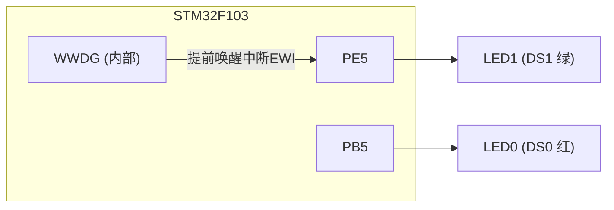
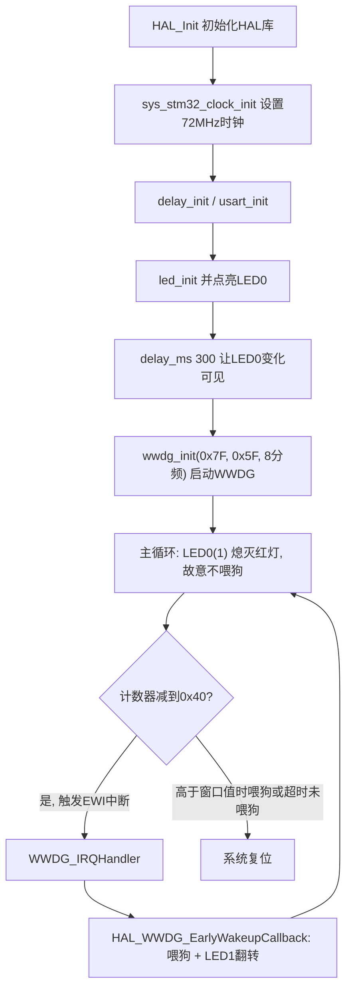

# 实验7 窗口看门狗实验

> 平台：正点原子 STM32F103（战舰）开发板 · HAL 库 · Keil MDK

## 一、实验简介

本实验学习 STM32 的**窗口看门狗（WWDG, Window Watchdog）**。程序启动后点亮 LED0 约 300ms 再开启窗口看门狗，随后主程序故意进入"死循环"不喂狗；当计数器减到窗口下限前一刻，触发**提前唤醒中断（EWI）**，在中断里喂狗并翻转 LED1，从而让系统"复活"。与实验6的独立看门狗相比，窗口看门狗**既不能喂得太晚，也不能喂得太早**，还多了一个可选的提前唤醒中断。

🏠 **生活类比**：窗口看门狗像一位"按点查岗"的宿管。他规定只能在查岗时间窗内打卡：来太早（计数器还高于窗口值）算作弊、来太晚（计数器减到 0x40 以下）算缺席，两种情况都要"通报批评"（复位芯片）。而在即将超时的前一刻，他会先敲一次门提醒你（提前唤醒中断），让你有机会补救。

## 二、实验目的

- 理解窗口看门狗 WWDG 的工作原理及其与独立看门狗 IWDG 的区别
- 掌握 WWDG 的**计数器值 T、窗口值 W、分频系数 WDGTB** 三个关键参数的设置
- 学会使能并处理 **提前唤醒中断（EWI）**，在中断中喂狗
- 熟悉 HAL 库 WWDG 驱动框架：`HAL_WWDG_Init → HAL_WWDG_IRQHandler → HAL_WWDG_EarlyWakeupCallback`

## 三、硬件资源与连接图

| 外设 | 引脚 | 说明 |
|------|------|------|
| LED0 (DS0, 红) | **PB5** | 低电平点亮，启动时亮 300ms 提示程序运行 |
| LED1 (DS1, 绿) | **PE5** | 低电平点亮，WWDG 提前唤醒中断中翻转 |
| 窗口看门狗 WWDG | 芯片内部资源 | 无需外部接线，时钟来自 PCLK1（36MHz） |



> 接线说明：LED 为板载资源，负极接 MCU 引脚，低电平点亮。WWDG 是芯片内部外设，不涉及外部连线。

## 四、核心寄存器（WWDG）

| 寄存器 | 名称 | 作用 |
|--------|------|------|
| `WWDG_CR` | 控制寄存器 | bit7 **WDGA**：写 1 激活看门狗（一旦置 1 只能复位清除）；bit[6:0] **T[6:0]**：计数器值，喂狗时装入的新值 |
| `WWDG_CFR` | 配置寄存器 | bit[6:0] **W[6:0]**：窗口值，计数器高于此值时喂狗会立即复位；bit[8:7] **WDGTB[1:0]**：时基分频（1/2/4/8）；bit9 **EWI**：提前唤醒中断使能 |
| `WWDG_SR` | 状态寄存器 | bit0 **EWIF**：提前唤醒中断标志，计数器减到 0x40 时置位 |

关键规则与计算：

```
看门狗时钟: Fwwdg = PCLK1 / (4096 * 2^WDGTB)     本实验 PCLK1=36MHz, WDGTB=8 分频
           Fwwdg = 36M / (4096 * 8) ≈ 1099 Hz   (每计 1 次约 910us)
超时复位:   计数器从 T 递减, 减到 0x40 再减 1 (即 0x3F) 时产生复位
喂狗窗口:   只有当 T[6:0] < W[6:0] 时写 CR 喂狗才合法, 否则立即复位
提前唤醒:   计数器减到 0x40 时触发 EWI 中断, 是复位前最后的喂狗机会
```

本实验参数：`wwdg_init(0x7F, 0x5F, WWDG_PRESCALER_8)`，即计数器 T=0x7F、窗口 W=0x5F、8 分频。从装入 0x7F 到触发 EWI 需计 0x7F−0x40+1=64 次，约 **58ms**，这就是 LED1 的翻转周期来源。

## 五、软件架构 / 流程



## 六、主要示例代码及讲解

### 1. WWDG 初始化（`Drivers/BSP/WDG/wdg.c`）

```c
WWDG_HandleTypeDef g_wwdg_handle;  /* WWDG句柄 */

void wwdg_init(uint8_t tr, uint8_t wr, uint32_t fprer)
{
    g_wwdg_handle.Instance = WWDG;
    g_wwdg_handle.Init.Prescaler = fprer;         /* 设置分频系数 */
    g_wwdg_handle.Init.Window = wr;               /* 设置窗口值 */
    g_wwdg_handle.Init.Counter = tr;              /* 设置计数器值 */
    g_wwdg_handle.Init.EWIMode = WWDG_EWI_ENABLE; /* 使能窗口看门狗提前唤醒中断 */
    HAL_WWDG_Init(&g_wwdg_handle);                /* 初始化WWDG */
}

void HAL_WWDG_MspInit(WWDG_HandleTypeDef *hwwdg)
{
    __HAL_RCC_WWDG_CLK_ENABLE();            /* 使能窗口看门狗时钟 */

    HAL_NVIC_SetPriority(WWDG_IRQn, 2, 3);  /* 抢占优先级2，子优先级为3 */
    HAL_NVIC_EnableIRQ(WWDG_IRQn);          /* 使能窗口看门狗中断 */
}
```

**讲解**：
- 三个参数分别写入 `WWDG_CR` 的 T[6:0]、`WWDG_CFR` 的 W[6:0] 和 WDGTB[1:0]。
- `WWDG_EWI_ENABLE` 置位 `CFR` 的 EWI 位，使"计数器到 0x40"时先进中断而不是直接复位。
- `HAL_WWDG_MspInit()` 是 HAL 的"底层钩子"，会被 `HAL_WWDG_Init()` 自动调用，负责开时钟和配 NVIC 中断。

### 2. 中断服务与喂狗回调（`Drivers/BSP/WDG/wdg.c`）

```c
void WWDG_IRQHandler(void)
{
    HAL_WWDG_IRQHandler(&g_wwdg_handle);  /* 调用WWDG共用中断处理函数 */
}

void HAL_WWDG_EarlyWakeupCallback(WWDG_HandleTypeDef *hwwdg)
{
    HAL_WWDG_Refresh(&g_wwdg_handle); /* 更新窗口看门狗值 */
    LED1_TOGGLE();                    /* LED1闪烁 */
}
```

**讲解**：
- 中断链路为：`WWDG_IRQHandler`（启动文件规定的中断向量名）→ `HAL_WWDG_IRQHandler`（HAL 公共处理，清标志）→ `HAL_WWDG_EarlyWakeupCallback`（用户回调）。
- `HAL_WWDG_Refresh()` 把计数器重装为 T=0x7F（写 `WWDG_CR`），完成喂狗。EWI 触发时计数器已到 0x40，低于窗口值 0x5F，所以此时喂狗一定合法；重装后计数器再次递减，约 58ms 后又一次到达 0x40、再次触发 EWI，如此循环。
- 每喂一次狗翻转一次 LED1，于是 LED1 以约 58ms 周期闪烁。

### 3. 主函数（`User/main.c`）

```c
int main(void)
{
    HAL_Init();                             /* 初始化HAL库 */
    sys_stm32_clock_init(RCC_PLL_MUL9);     /* 设置时钟, 72Mhz */
    delay_init(72);                         /* 延时初始化 */
    usart_init(115200);                     /* 串口初始化为115200 */
    led_init();                             /* 初始化LED */
    LED0(0);                                /* 点亮LED0 红灯 */
    delay_ms(300);                          /* 延时300ms再初始化看门狗,LED0的变化"可见" */
    wwdg_init(0X7F, 0X5F, WWDG_PRESCALER_8);/* 计数器值为7f,窗口寄存器为5f,分频数为8 */

    while (1)
    {
        LED0(1);                            /* 关闭红灯 */
    }
}
```

**讲解**：先点亮 LED0 并延时 300ms，是为了让"红灯亮过"这一现象肉眼可见；随后启动 WWDG，主循环里**故意什么都不做、不喂狗**，把喂狗任务完全交给提前唤醒中断。若把 `wwdg_init` 或中断里的喂狗代码注释掉，系统将在约 58ms 后复位，LED0 会周期性地"亮一下又灭"，这就是看门狗复位的效果。

## 七、实验效果

烧录后：**LED0（红）只在启动瞬间亮约 300ms**，随后熄灭（主循环将其关闭）；**LED1（绿）不停闪烁**——每约 58ms 由窗口看门狗提前唤醒中断翻转一次。这说明程序虽然"卡"在死循环里，但 WWDG 中断仍在正常工作、按时喂狗，系统没有被复位。

## 八、注意事项

- WWDG 一旦通过 WDGA 位激活，**软件无法关闭**，只能等复位；调试时若在中断里断点停住，芯片会被看门狗复位。
- 喂狗必须落在窗口内：计数器值 **高于窗口值 W 时喂狗会立即复位**，低于 0x40 后未喂狗也会复位。
- WWDG 时钟来自 PCLK1，使用 8 分频时最短/最长超时时间可参考《STM32F10xxx 参考手册》(RM0008) 的 WWDG 章节表格。
- 提前唤醒中断（EWI）是复位前**唯一**的补救机会，务必保证其中断服务程序足够短、能及时执行。
- 修改代码后需重新编译烧录；若烧录失败可先运行根目录 `keilkill.bat` 结束占用进程。

## 九、文件结构

```
实验7 窗口看门狗实验/
├── User/
│   ├── main.c              主程序（启动WWDG后进入死循环）
│   ├── stm32f1xx_it.c      中断服务函数
│   └── stm32f1xx_hal_conf.h HAL配置
├── Drivers/
│   ├── BSP/
│   │   ├── LED/            LED 驱动 (led.c / led.h)
│   │   └── WDG/            看门狗驱动 (wdg.c / wdg.h, 含IWDG与WWDG)
│   ├── SYSTEM/             delay / sys / usart 系统支持
│   ├── CMSIS/              内核启动与设备定义
│   └── STM32F1xx_HAL_Driver/ ST HAL 库
├── Projects/MDK-ARM/       Keil 工程文件 (.uvprojx)
└── readme.txt              实验说明（GBK编码）
```
