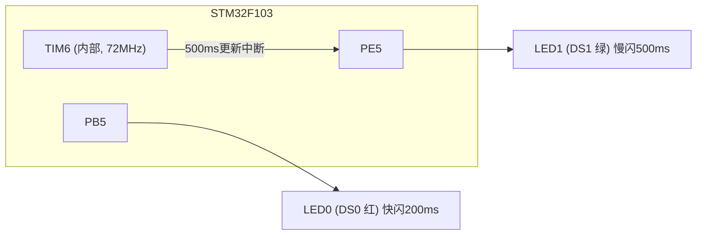
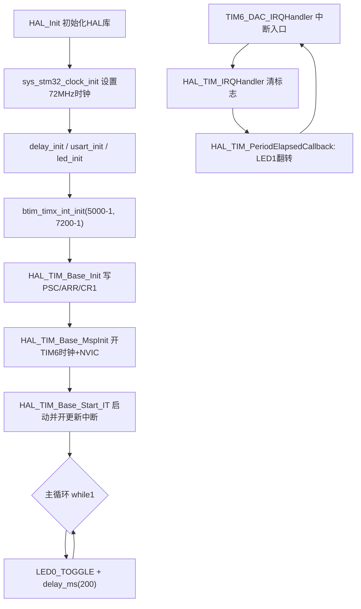

# 实验8 基本定时器实验

> 平台：正点原子 STM32F103（战舰）开发板 · HAL 库 · Keil MDK

本目录包含一个子实验：**实验8-1 基本定时器中断实验**（完整工程位于 `实验8-1 基本定时器中断实验/`）。

## 一、实验简介

本实验使用 STM32 的**基本定时器 TIM6** 实现精确定时中断：配置 TIM6 每 500ms 产生一次更新中断，在中断服务程序里翻转 LED1；主循环中用软件延时让 LED0 以 200ms 翻转。下载后可见 LED0 快闪、LED1 慢闪，两灯互不干扰——这就是"定时器中断在后台独立工作"的直观体现。基本定时器只有定时功能（无外部引脚、无输入捕获/PWM），是最简单的定时器，适合作为定时器学习的入门实验。

🏠 **生活类比**：基本定时器就像厨房里的机械计时器。你上好发条（设定分频和计数值），它自己"嘀嗒"倒数，时间一到就响铃（触发中断）提醒你做事（翻转 LED），而你完全可以继续干别的活（主循环），不用一直盯着它。

## 二、实验目的

- 了解 STM32 三类定时器（基本/通用/高级）的区别，掌握基本定时器 TIM6/TIM7 的用途
- 理解定时器**预分频器 PSC、自动重装载值 ARR、计数器 CNT** 的定时计算方法
- 掌握 HAL 库定时器中断的配置流程：`HAL_TIM_Base_Init → HAL_TIM_Base_Start_IT → 中断回调`
- 学会在 `HAL_TIM_PeriodElapsedCallback()` 中编写定时业务代码

## 三、硬件资源与连接图

| 外设 | 引脚 | 说明 |
|------|------|------|
| LED0 (DS0, 红) | **PB5** | 低电平点亮，主循环中每 200ms 翻转（快闪） |
| LED1 (DS1, 绿) | **PE5** | 低电平点亮，TIM6 中断中每 500ms 翻转（慢闪） |
| 基本定时器 TIM6 | 芯片内部资源 | 时钟来自 APB1×2 = 72MHz，无外部引脚 |



## 四、核心寄存器（TIM6）

| 寄存器 | 名称 | 作用 |
|--------|------|------|
| `TIM6_CR1` | 控制寄存器1 | bit0 **CEN**：使能计数器；bit7 **ARPE**：ARR 预装载使能（缓冲写） |
| `TIM6_PSC` | 预分频寄存器 | PSC[15:0]，计数时钟 = 定时器时钟 / (PSC+1)，范围 1~65536 分频 |
| `TIM6_ARR` | 自动重装载寄存器 | 计数到 ARR 值后产生更新事件并清零重计 |
| `TIM6_CNT` | 计数器寄存器 | 当前计数值，按 PSC 分频后的时钟递增 |
| `TIM6_DIER` | 中断使能寄存器 | bit0 **UIE**：更新中断使能 |
| `TIM6_SR` | 状态寄存器 | bit0 **UIF**：更新中断标志（计满溢出时置位） |
| `TIM6_EGR` | 事件产生寄存器 | bit0 **UG**：软件产生一次更新事件（初始化时用于装载 PSC） |

定时时间计算公式（源码注释中给出）：

```
Tout = ((arr + 1) * (psc + 1)) / Ft   单位: us, Ft = 定时器时钟(MHz)
```

本实验：TIM6 时钟来自 APB1，PPRE1 为 2 分频时定时器时钟是 APB1 的 2 倍 = **72MHz**。取 `psc = 7200-1`、`arr = 5000-1`：计数频率 = 72M/7200 = **10kHz**，计数 5000 次 = **500ms** 中断一次。

> 注意：基本定时器没有 `CCMR/CCER/CCR` 等通道寄存器（那是通用/高级定时器的），也没有外部引脚，功能上"只会定时"。

## 五、软件架构 / 流程



## 六、主要示例代码及讲解

### 1. 基本定时器中断初始化（`Drivers/BSP/TIMER/btim.c`）

```c
TIM_HandleTypeDef g_timx_handle;  /* 定时器句柄 */

void btim_timx_int_init(uint16_t arr, uint16_t psc)
{
    g_timx_handle.Instance = BTIM_TIMX_INT;                      /* 通用定时器X */
    g_timx_handle.Init.Prescaler = psc;                          /* 设置预分频系数 */
    g_timx_handle.Init.CounterMode = TIM_COUNTERMODE_UP;         /* 递增计数模式 */
    g_timx_handle.Init.Period = arr;                             /* 自动装载值 */
    HAL_TIM_Base_Init(&g_timx_handle);

    HAL_TIM_Base_Start_IT(&g_timx_handle);    /* 使能定时器x及其更新中断 */
}
```

**讲解**：
- `TIM_HandleTypeDef` 是 HAL 库的"定时器配置单+状态本"，填好 Instance（选 TIM6）、Prescaler、Period 后交给 `HAL_TIM_Base_Init()` 一次性写入 `PSC/ARR/CR1` 寄存器。
- `TIM_COUNTERMODE_UP` 为递增计数：CNT 从 0 数到 ARR，触发更新事件后自动清零重数。
- `HAL_TIM_Base_Start_IT()` 做两件事：置位 `CR1` 的 CEN 启动计数、置位 `DIER` 的 UIE 允许更新中断。
- 选用哪个定时器由 `btim.h` 中的宏决定：`#define BTIM_TIMX_INT TIM6`，改这组宏即可换成 TIM1~TIM8 任意定时器。

### 2. MSP 初始化与中断服务（`Drivers/BSP/TIMER/btim.c`）

```c
void HAL_TIM_Base_MspInit(TIM_HandleTypeDef *htim)
{
    if (htim->Instance == BTIM_TIMX_INT)
    {
        BTIM_TIMX_INT_CLK_ENABLE();                     /* 使能TIM时钟 */
        HAL_NVIC_SetPriority(BTIM_TIMX_INT_IRQn, 1, 3); /* 抢占1，子优先级3，组2 */
        HAL_NVIC_EnableIRQ(BTIM_TIMX_INT_IRQn);         /* 开启ITM3中断 */
    }
}

void BTIM_TIMX_INT_IRQHandler(void)   /* 即 TIM6_DAC_IRQHandler */
{
    HAL_TIM_IRQHandler(&g_timx_handle); /* 定时器中断公共处理函数 */
}

void HAL_TIM_PeriodElapsedCallback(TIM_HandleTypeDef *htim)
{
    if (htim->Instance == BTIM_TIMX_INT)
    {
        LED1_TOGGLE(); /* LED1反转 */
    }
}
```

**讲解**：
- `HAL_TIM_Base_MspInit()` 会被 `HAL_TIM_Base_Init()` 自动回调，负责开外设时钟和配置 NVIC——外设初始化与底层硬件配置分离，是 HAL 库的固定套路。
- TIM6 的中断向量名是 `TIM6_DAC_IRQHandler`（与 DAC 共用），这里通过 `btim.h` 的宏 `BTIM_TIMX_INT_IRQHandler` 映射，便于换定时器时自动改名。
- 中断入口只做"清标志+分发"，真正的业务代码写在回调 `HAL_TIM_PeriodElapsedCallback()` 中，`htim->Instance` 判断可区分多个定时器共用同一回调。

### 3. 主函数（`User/main.c`）

```c
int main(void)
{
    HAL_Init();                             /* 初始化HAL库 */
    sys_stm32_clock_init(RCC_PLL_MUL9);     /* 设置时钟, 72Mhz */
    delay_init(72);                         /* 延时初始化 */
    usart_init(115200);                     /* 串口初始化为115200 */
    led_init();                             /* 初始化LED */
    btim_timx_int_init(5000 - 1, 7200 - 1); /* 10Khz的计数频率，计数5K次为500ms */

    while (1)
    {
        LED0_TOGGLE();
        delay_ms(200);
    }
}
```

**讲解**：定时器初始化后主循环不再干预 LED1，它完全由中断驱动；LED0 则用"阻塞延时"方式每 200ms 翻转。想改变 LED1 闪烁周期，只需修改 `arr`：如 `btim_timx_int_init(10000-1, 7200-1)` 即变为 1 秒中断一次。

## 七、实验效果

烧录程序后：**LED0（红）以约 400ms 为周期快闪**（200ms 翻转一次），**LED1（绿）以约 1000ms 为周期慢闪**（500ms 中断翻转一次）。两灯节奏明显不同，说明定时器中断与主循环并行工作、互不阻塞。

## 八、注意事项

- 定时器时钟不等于 APB1 时钟：当 APB1 预分频系数 ≥2 时，TIM2~TIM7 的时钟是 APB1 的 **2 倍**（本实验为 72MHz），计算定时时间时别用错。
- `arr`、`psc` 都是"**写入值 = 实际值 − 1**"的关系，所以代码里写成 `5000-1`、`7200-1`，更直观且不易算错。
- PSC 在运行中修改后，要等下一次更新事件才生效（HAL 初始化时会自动产生 UG 事件装载）。
- 中断服务程序应尽量短，耗时任务放主循环，否则会影响系统实时性。
- 修改代码后需重新编译烧录；若烧录失败可先运行根目录 `keilkill.bat` 结束占用进程。

## 九、文件结构

```
实验8 基本定时器实验/
└── 实验8-1 基本定时器中断实验/
    ├── User/
    │   ├── main.c              主程序（LED0快闪，TIM6中断翻转LED1）
    │   ├── stm32f1xx_it.c      中断服务函数
    │   └── stm32f1xx_hal_conf.h HAL配置
    ├── Drivers/
    │   ├── BSP/
    │   │   ├── LED/            LED 驱动 (led.c / led.h)
    │   │   └── TIMER/          基本定时器驱动 (btim.c / btim.h)
    │   ├── SYSTEM/             delay / sys / usart 系统支持
    │   ├── CMSIS/              内核启动与设备定义
    │   └── STM32F1xx_HAL_Driver/ ST HAL 库
    ├── Projects/MDK-ARM/       Keil 工程文件 (.uvprojx)
    └── readme.txt              实验说明（GBK编码）
```
