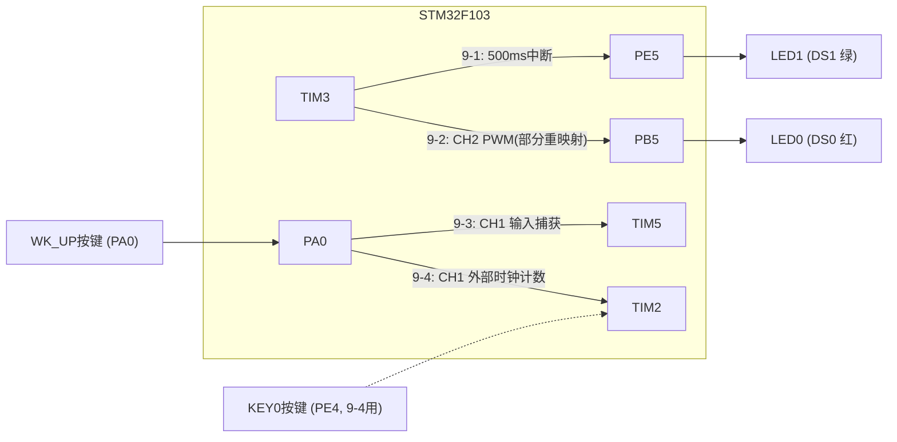
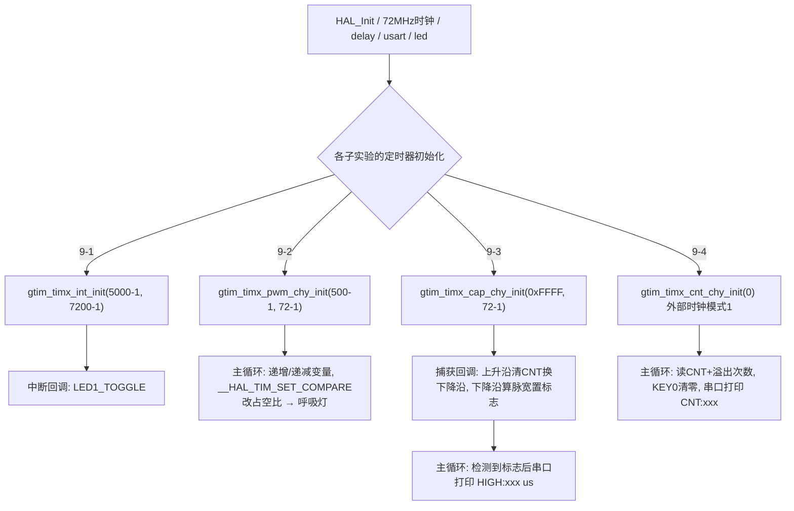

# 实验9 通用定时器实验

> 平台：正点原子 STM32F103（战舰）开发板 · HAL 库 · Keil MDK

本目录包含四个子实验，每个子实验是一个完整工程：

| 子实验 | 功能 | 使用的定时器 |
|--------|------|--------------|
| 实验9-1 通用定时器中断实验 | 500ms 定时中断翻转 LED1 | TIM3 |
| 实验9-2 通用定时器PWM输出实验 | PWM 呼吸灯（控制 LED0 亮度） | TIM3 通道2 → PB5（部分重映射） |
| 实验9-3 通用定时器输入捕获实验 | 测量 PA0 上高电平脉宽并串口打印 | TIM5 通道1 ← PA0 |
| 实验9-4 通用定时器脉冲计数实验 | 对外部脉冲计数并串口打印 | TIM2 通道1 ← PA0（外部时钟模式1） |

## 一、实验简介

通用定时器（TIM2~TIM5）是 STM32 中应用最广的定时器：它既能像基本定时器一样**定时中断**，又能**输出 PWM**、**输入捕获测脉宽**、**对外部脉冲计数**。本实验通过 4 个子实验，把通用定时器的四大典型应用各演示一遍——所有子实验的驱动都放在 `Drivers/BSP/TIMER/gtim.c` 中，通过 `gtim.h` 里的一组宏来切换定时器与通道，代码结构高度统一，便于对照学习。

🏠 **生活类比**：通用定时器像一台多功能洗衣机：定时模式（到点响铃＝定时中断）、变频模式（调节转速＝PWM 调占空比）、秒表模式（记录一次进水用了多久＝输入捕获测脉宽）、计数模式（数洗了几件衣服＝外部脉冲计数）。一台机器，四种玩法，核心都是"数数"。

## 二、实验目的

- 掌握通用定时器**定时中断、PWM 输出、输入捕获、外部脉冲计数**四种工作模式的配置方法
- 理解 `PSC/ARR/CNT/CCMR/CCER/SMCR/CCR` 等核心寄存器在各模式中的作用
- 学会定时器引脚**重映射（REMAP）**的方法（如 TIM3_CH2 部分重映射到 PB5）
- 掌握 HAL 库回调机制：`HAL_TIM_PeriodElapsedCallback` / `HAL_TIM_IC_CaptureCallback`
- 学会用 `__HAL_TIM_SET_COMPARE()` 等宏在运行时修改占空比、读取捕获值

## 三、硬件资源与连接图

| 子实验 | 外设 | 引脚 | 说明 |
|--------|------|------|------|
| 9-1 | LED0 / LED1 | PB5 / PE5 | LED0 主循环 200ms 快闪；LED1 由 TIM3 中断 500ms 翻转 |
| 9-2 | TIM3_CH2 | **PB5** | PWM 输出直接控制 LED0（部分重映射 TIM3_CH2 → PB5） |
| 9-3 | TIM5_CH1 | **PA0** | 输入捕获，接 WK_UP 按键模拟高电平脉冲 |
| 9-4 | TIM2_CH1 | **PA0** | 外部脉冲计数输入，WK_UP 按键产生脉冲 |
| 9-4 | KEY0 | **PE4** | 按下清零重新计数 |



> 9-2 中 PWM 输出脚 PB5 恰好就是 LED0，因此改变占空比即可改变 LED0 亮度，形成呼吸灯；无需外接任何线路。9-3/9-4 的 PA0 即 WK_UP 按键，按键按下接 3.3V，松开为 0（9-3 配置为下拉输入）。

## 四、核心寄存器（通用定时器 TIMx）

| 寄存器 | 名称 | 作用 |
|--------|------|------|
| `TIMx_CR1` | 控制寄存器1 | bit0 **CEN** 使能计数；bit4 **DIR** 计数方向；bit[6:5] **CMS** 中心对齐模式；bit7 **ARPE** ARR 预装载 |
| `TIMx_SMCR` | 从模式控制寄存器 | **SMS[2:0]** 从模式选择（9-4 用 111＝外部时钟模式1）；**TS[2:0]** 触发源选择（选 TI1FP1） |
| `TIMx_DIER` | 中断使能寄存器 | bit0 **UIE** 更新中断；bit1 **CC1IE** 捕获/比较1中断 |
| `TIMx_SR` | 状态寄存器 | 各中断标志位（UIF、CC1IF 等） |
| `TIMx_CNT` | 计数器 | 当前计数值；输入捕获时由硬件自动锁存到 CCR |
| `TIMx_PSC` | 预分频器 | 计数时钟 = 72MHz / (PSC+1) |
| `TIMx_ARR` | 自动重装载寄存器 | 计满产生更新事件；PWM 模式下决定周期 |
| `TIMx_CCMR1/2` | 捕获/比较模式寄存器 | **OCxM[2:0]** 输出比较模式（110/111＝PWM1/2）；**CCxS** 通道方向（01＝输入捕获 ICx 映射到 TIx）；**ICxPSC/ICxF** 捕获分频与滤波 |
| `TIMx_CCER` | 捕获/比较使能寄存器 | **CCxE** 通道输出/捕获使能；**CCxP** 极性（PWM 输出电平极性、捕获边沿极性） |
| `TIMx_CCRx` | 捕获/比较寄存器 | PWM 模式下＝比较值（决定占空比）；捕获模式下＝硬件锁存的 CNT 快照 |

各子实验参数计算（定时器时钟均为 72MHz，`Tout = ((arr+1)*(psc+1))/Ft`）：

```
9-1: arr=5000-1, psc=7200-1 → 10kHz计数, 500ms更新中断
9-2: arr=500-1,  psc=72-1   → 1MHz计数, 2kHz PWM (周期500us)
9-3: arr=0xFFFF, psc=72-1   → 1MHz计数, 每计数1次=1us, 最长可测约4194303us
9-4: arr=65535,  psc=0      → 不分频, PA0每个上升沿CNT加1
```

## 五、软件架构 / 流程



## 六、主要示例代码及讲解

### 1. PWM 输出初始化（`实验9-2 .../Drivers/BSP/TIMER/gtim.c`）

```c
void gtim_timx_pwm_chy_init(uint16_t arr, uint16_t psc)
{
    TIM_OC_InitTypeDef timx_oc_pwm_chy  = {0};                          /* 定时器PWM输出配置 */

    g_timx_pwm_chy_handle.Instance = GTIM_TIMX_PWM;                     /* 定时器x */
    g_timx_pwm_chy_handle.Init.Prescaler = psc;                         /* 定时器分频 */
    g_timx_pwm_chy_handle.Init.CounterMode = TIM_COUNTERMODE_UP;        /* 递增计数模式 */
    g_timx_pwm_chy_handle.Init.Period = arr;                            /* 自动重装载值 */
    HAL_TIM_PWM_Init(&g_timx_pwm_chy_handle);                           /* 初始化PWM */

    timx_oc_pwm_chy.OCMode = TIM_OCMODE_PWM1;                           /* 模式选择PWM1 */
    timx_oc_pwm_chy.Pulse = arr / 2;                                    /* 设置比较值,此值用来确定占空比 */
                                                                        /* 默认比较值为自动重装载值的一半,即占空比为50% */
    timx_oc_pwm_chy.OCPolarity = TIM_OCPOLARITY_LOW;                    /* 输出比较极性为低 */
    HAL_TIM_PWM_ConfigChannel(&g_timx_pwm_chy_handle, &timx_oc_pwm_chy, GTIM_TIMX_PWM_CHY); /* 配置TIMx通道y */
    HAL_TIM_PWM_Start(&g_timx_pwm_chy_handle, GTIM_TIMX_PWM_CHY);       /* 开启对应PWM通道 */
}
```

**讲解**：
- `TIM_OCMODE_PWM1` 写入 `CCMR` 的 OCxM=110：CNT < CCR 时输出有效电平，否则无效——CCR 越大占空比越大。
- `TIM_OCPOLARITY_LOW` 写入 `CCER` 的 CCxP：有效电平定义为低。LED0 是低电平点亮，所以占空比越大灯越亮。
- TIM3_CH2 默认引脚是 PB7，要用 PB5 必须做**部分重映射**，由 `gtim.h` 的宏完成：`__HAL_AFIO_REMAP_TIM3_PARTIAL()`（先开 AFIO 时钟）。
- 主循环里用 `__HAL_TIM_SET_COMPARE(&g_timx_pwm_chy_handle, GTIM_TIMX_PWM_CHY, ledrpwmval)` 不停改写 CCR2（0→300→0 往返），LED0 便由暗到亮再到暗，形成呼吸灯。

### 2. 输入捕获初始化与回调（`实验9-3 .../Drivers/BSP/TIMER/gtim.c`）

```c
void gtim_timx_cap_chy_init(uint16_t arr, uint16_t psc)
{
    TIM_IC_InitTypeDef timx_ic_cap_chy = {0};

    g_timx_cap_chy_handle.Instance = GTIM_TIMX_CAP;                     /* 定时器5 */
    g_timx_cap_chy_handle.Init.Prescaler = psc;                         /* 定时器分频 */
    g_timx_cap_chy_handle.Init.CounterMode = TIM_COUNTERMODE_UP;        /* 递增计数模式 */
    g_timx_cap_chy_handle.Init.Period = arr;                            /* 自动重装载值 */
    HAL_TIM_IC_Init(&g_timx_cap_chy_handle);

    timx_ic_cap_chy.ICPolarity = TIM_ICPOLARITY_RISING;                 /* 上升沿捕获 */
    timx_ic_cap_chy.ICSelection = TIM_ICSELECTION_DIRECTTI;             /* 映射到TI1上 */
    timx_ic_cap_chy.ICPrescaler = TIM_ICPSC_DIV1;                       /* 配置输入分频，不分频 */
    timx_ic_cap_chy.ICFilter = 0;                                       /* 配置输入滤波器，不滤波 */
    HAL_TIM_IC_ConfigChannel(&g_timx_cap_chy_handle, &timx_ic_cap_chy, GTIM_TIMX_CAP_CHY);  /* 配置TIM5通道1 */

    __HAL_TIM_ENABLE_IT(&g_timx_cap_chy_handle, TIM_IT_UPDATE);         /* 使能更新中断 */
    HAL_TIM_IC_Start_IT(&g_timx_cap_chy_handle, GTIM_TIMX_CAP_CHY);     /* 开始捕获TIM5的通道1 */
}
```

```c
void HAL_TIM_IC_CaptureCallback(TIM_HandleTypeDef *htim)
{
    if (htim->Instance == GTIM_TIMX_CAP)
    {
        if ((g_timxchy_cap_sta & 0X80) == 0)                /* 还未成功捕获 */
        {
            if (g_timxchy_cap_sta & 0X40)                   /* 捕获到一个下降沿 */
            {
                g_timxchy_cap_sta |= 0X80;                  /* 标记成功捕获到一次高电平脉宽 */
                g_timxchy_cap_val = HAL_TIM_ReadCapturedValue(&g_timx_cap_chy_handle, GTIM_TIMX_CAP_CHY);  /* 获取当前的捕获值 */
                TIM_RESET_CAPTUREPOLARITY(&g_timx_cap_chy_handle, GTIM_TIMX_CAP_CHY);                      /* 一定要先清除原来的设置 */
                TIM_SET_CAPTUREPOLARITY(&g_timx_cap_chy_handle, GTIM_TIMX_CAP_CHY, TIM_ICPOLARITY_RISING); /* 配置TIM5通道1上升沿捕获 */
            }
            else /* 还未开始,第一次捕获上升沿 */
            {
                g_timxchy_cap_sta = 0;
                g_timxchy_cap_val = 0;
                g_timxchy_cap_sta |= 0X40;                          /* 标记捕获到了上升沿 */
                __HAL_TIM_SET_COUNTER(&g_timx_cap_chy_handle, 0);   /* 定时器5计数器清零 */
                TIM_RESET_CAPTUREPOLARITY(&g_timx_cap_chy_handle, GTIM_TIMX_CAP_CHY);   /* 一定要先清除原来的设置！！ */
                TIM_SET_CAPTUREPOLARITY(&g_timx_cap_chy_handle, GTIM_TIMX_CAP_CHY, TIM_ICPOLARITY_FALLING); /* 定时器5通道1设置为下降沿捕获 */
            }
        }
    }
}
```

**讲解**：
- 输入捕获的本质：边沿到来时，硬件把当时的 `CNT` 快照到 `CCR1` 并触发中断——相当于给信号"拍照记时间"。
- 测脉宽用"**两次捕获法**"：捕获到上升沿→清零 CNT、切换为下降沿捕获；捕获到下降沿→读出 CNT（即高电平时间）、置完成标志 0x80。状态字 `g_timxchy_cap_sta` 的 bit6=已捕获上升沿、bit7=一次测量完成，低 6 位记录溢出次数。
- `psc=72-1` 让计数频率为 1MHz，1 个计数正好 1us，捕获值直接就是微秒数。
- 主循环检测到 `cap_sta & 0x80` 后计算 `溢出次数×65536 + 捕获值`，串口打印 `HIGH:xxx us`。按下 WK_UP 键的时间越长，打印的脉宽越大。

### 3. 外部脉冲计数初始化（`实验9-4 .../Drivers/BSP/TIMER/gtim.c`）

```c
void gtim_timx_cnt_chy_init(uint16_t psc)
{
    /* ... GPIO配置为PA0下拉的复用推挽 ... */
    g_timx_cnt_chy_handle.Instance = GTIM_TIMX_CNT;                          /* 定时器2(TIM2) */
    g_timx_cnt_chy_handle.Init.Prescaler = psc;                              /* 定时器分频 */
    g_timx_cnt_chy_handle.Init.CounterMode = TIM_COUNTERMODE_UP;             /* 递增计数模式 */
    g_timx_cnt_chy_handle.Init.Period = 65535;                               /* 自动重装载值 */
    HAL_TIM_IC_Init(&g_timx_cnt_chy_handle);

    /* 从模式：外部触发模式1 */
    tim_slave_config.SlaveMode = TIM_SLAVEMODE_EXTERNAL1;                    /* 从模式：外部触发模式1 */
    tim_slave_config.InputTrigger = TIM_TS_TI1FP1;                           /* 输入触发：选择 TI1FP1(TIMX_CH1) 作为输入源 */
    tim_slave_config.TriggerPolarity = TIM_TRIGGERPOLARITY_RISING;           /* 触发极性：上升沿 */
    tim_slave_config.TriggerPrescaler = TIM_TRIGGERPRESCALER_DIV1;           /* 触发预分频：无 */
    tim_slave_config.TriggerFilter = 0x0;                                    /* 滤波：本例中不需要任何滤波 */
    HAL_TIM_SlaveConfigSynchro(&g_timx_cnt_chy_handle, &tim_slave_config);
    /* ... NVIC设置、使能更新中断、启动捕获 ... */
}
```

**讲解**：
- 关键是把计数时钟从内部 72MHz 换成**外部引脚信号**：`SMCR` 的 SMS=111（外部时钟模式1）、TS=TI1FP1，于是 PA0 上每来一个上升沿，CNT 加 1。
- ARR=65535，计满溢出一次进一次更新中断，驱动里用变量累计溢出次数；总脉冲数 = 溢出次数×65536 + 当前 CNT。
- 主循环中 `gtim_timx_cnt_chy_get_count()` 读总数并串口打印 `CNT:xxx`；按 **KEY0** 调 `gtim_timx_cnt_chy_restart()` 清零重计；按 **WK_UP** 产生一个脉冲，计数加 1。

## 七、实验效果

- **9-1**：LED0 快闪（200ms 翻转）、LED1 慢闪（500ms 中断翻转，1000ms 一个周期）。
- **9-2**：LED0 由暗到亮、再由亮到暗，循环往复，形成"呼吸灯"。
- **9-3**：按住 WK_UP 键再松开，串口（115200）打印 `HIGH:xxx us`，即按键按下的时长；LED0 闪烁提示程序运行。
- **9-4**：每按一次 WK_UP，串口打印的 `CNT:xxx` 加 1；按 KEY0 计数清零重来；LED0 闪烁提示程序运行。

## 八、注意事项

- 9-3/9-4 需要串口：电脑端串口助手波特率必须为 **115200**，建议使用 XCOM/SSCOM（其他助手可能控制 DTR/RTS 导致 MCU 复位）；USB 线接 **USB_UART** 口；排针 **P4 的 PA9/PA10 必须用跳线帽连接到 RXD/TXD**。
- 9-2 使用的 PB5 与 LED0 是同一引脚，初始化顺序上先 `led_init()` 再 PWM 初始化，后者会把 PB5 重新配置为复用推挽。
- 使用非默认引脚输出/捕获时必须做重映射（先 `__HAL_RCC_AFIO_CLK_ENABLE()`），9-2 为 TIM3 部分重映射。
- 9-3 可测的最长脉宽约 4194303us（由 6 位溢出计数×65536+16 位 CNT 决定），超时会不准。
- 更换定时器/通道只需修改 `gtim.h` 中的一组宏（含中断向量名、时钟使能宏），驱动代码无需改动。
- 修改代码后需重新编译烧录；若烧录失败可先运行根目录 `keilkill.bat`。

## 九、文件结构

```
实验9 通用定时器实验/
├── 实验9-1 通用定时器中断实验/
│   ├── User/main.c             主程序（LED0快闪）
│   └── Drivers/BSP/
│       ├── LED/                LED 驱动
│       └── TIMER/gtim.c(.h)    TIM3 定时中断驱动
├── 实验9-2 通用定时器PWM输出实验/
│   ├── User/main.c             呼吸灯主循环（改CCR2）
│   └── Drivers/BSP/TIMER/      TIM3_CH2 PWM驱动（PB5部分重映射）
├── 实验9-3 通用定时器输入捕获实验/
│   ├── User/main.c             脉宽计算与串口打印
│   └── Drivers/BSP/TIMER/      TIM5_CH1 输入捕获驱动（PA0）
├── 实验9-4 通用定时器脉冲计数实验/
│   ├── User/main.c             计数打印、KEY0清零
│   └── Drivers/BSP/
│       ├── KEY/                按键驱动 (KEY0-PE4, WK_UP-PA0)
│       └── TIMER/              TIM2 外部时钟计数驱动（PA0）
└── （各子实验均含 SYSTEM / CMSIS / STM32F1xx_HAL_Driver /
    Projects-MDK-ARM 工程文件 与 readme.txt）
```
